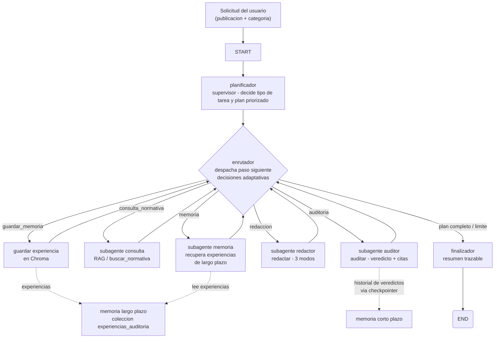
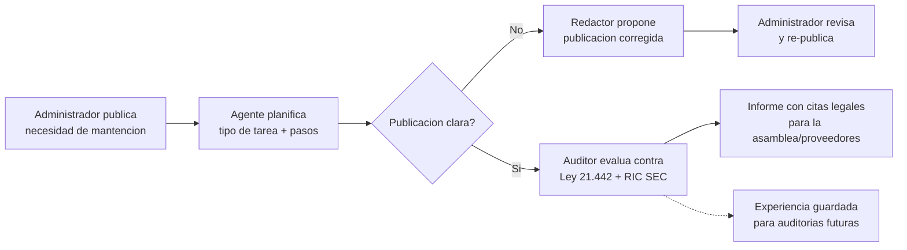
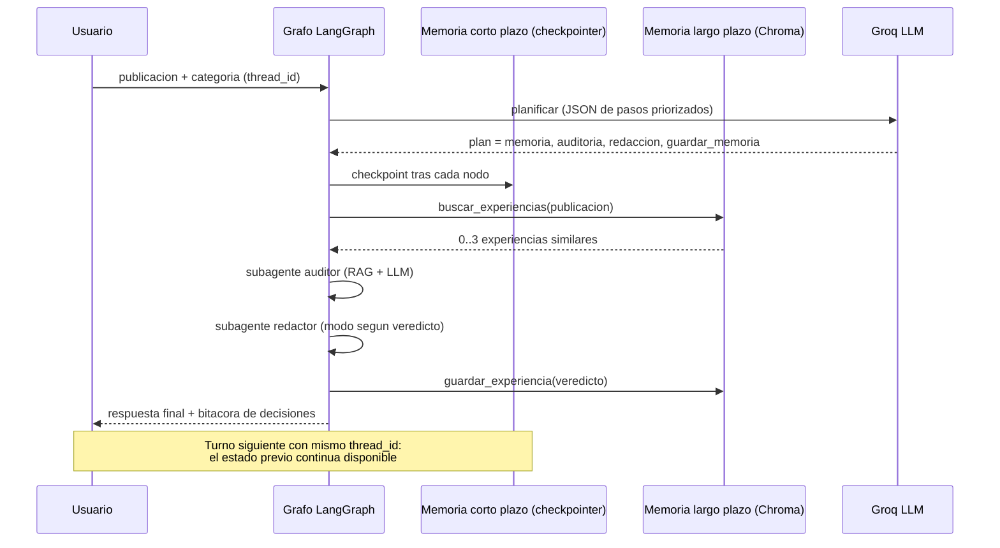

# Diagramas de orquestación — Agente Auditor Comunitario (IE8)

## 1. Diagrama general de orquestación (LangGraph)



## 2. Flujo de trabajo organizacional resuelto

Caso: administrador de comunidad publica una necesidad de mantención.



## 3. Secuencia de una ejecución (con memoria)



## 4. Arquitectura de módulos (capas)

```
┌────────────────────────────────────────────────────────────┐
│ INTERFACES                                                  │
│   CLI (src/grafo/cli.py)             MCP server (EV1)       │
├────────────────────────────────────────────────────────────┤
│ ORQUESTACION (LangGraph)                                    │
│   src/grafo/grafo.py      StateGraph + aristas condicionales│
│   src/grafo/planificador.py   plan LLM + heuristica fallback│
│   src/grafo/enrutador.py      despacho + reintentos         │
│   src/grafo/subagentes.py     1 subagente por herramienta   │
├────────────────────────────────────────────────────────────┤
│ HERRAMIENTAS (IE1)                                          │
│   consulta.py (RAG)   razonamiento.py (auditar)   escritura │
├────────────────────────────────────────────────────────────┤
│ MEMORIA (IE3)                                               │
│   corto_plazo.py (checkpointer)   largo_plazo.py (Chroma)   │
├────────────────────────────────────────────────────────────┤
│ BASE (EV1, sin cambios)                                     │
│   retriever (Chroma+MiniLM)   llm.py (Groq)   prompts.py v2 │
│   indexer (ingesta->chunks->embeddings->build_index)        │
└────────────────────────────────────────────────────────────┘
```

## 5. Evidencias

- Bitácora real de 5 escenarios: `data/eval/ev2/` (generada con `python -m scripts.demo_agente_ev2`).
- Logs de ejecución por paso: `data/agente_ejecuciones.jsonl`.
- Tests del grafo, memoria y herramientas: `tests/test_grafo.py`, `tests/test_memoria.py`, `tests/test_herramientas.py`.
